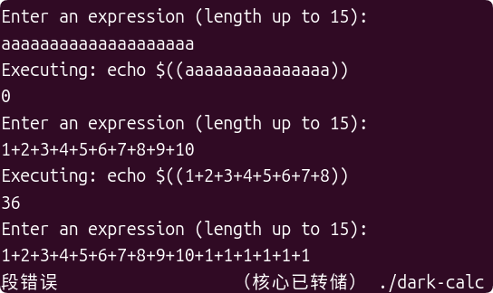
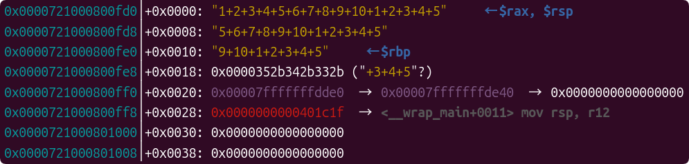

## AttackLab 实验报告

> ——吴童 25803050055

### 实验过程

#### 任务：观察栈帧 `input`

1. 显然是 `main()` 调用的。
2. 由于 `rbp` 是 callee-save 的，先 `push` 进栈保存，然后使得 `rbp` 保存当前函数栈帧的起点，然后移动 `rsp` 在栈上再开 `0x10 byte` 的空间。
	`rbp` 里的数值是 `push` 之后的 `rsp`，那里存的值是 `push` 进去的老的 `rbp`。
3. gef 直接打出来了，`0x401ad1`，这个地址存的是代码 `mov eax 0x0`。应该是函数结束之后下一个应该执行什么，即 `rip` 的新值。
4. `call 0x401977`。
5. `call`：返回地址压栈，`rip` 改为调用的子函数。
	prologue：`rbp` 压栈，`rbp` 改为栈帧起点（这个起点位置存的就是老的 `rbp`）。
	`leave`：回滚 prologue（相当于 `mov rsp,rbp` `pop rbp`），恢复 `rbp` 的原值，`rsp` 再次指向返回地址。
	`ret`：弹栈，`rip` 指向返回地址。

#### 用不同长度的字符串输入测试 `dark-calc`



如果输入超过 15 字符但是较短，不会发生错误，并在后面的处理中截取前 15 个字符，再输出和 `system` 运行。如果远远超过 15 字符，会直接段错误。

这个字符数组就是开在栈上的。`gets` 写入越界之后，会一直往后写，覆盖后面的值。



如图，覆盖了栈里存的 `rbp` 原值和返回地址。如果输入更长的字符串，还会写入上一个栈帧。

#### 任务：利用缓冲区漏洞执行 `./malware`

虽然 42 是答案，但是阅读 `input` 的代码可以得知输入的代码被 `strcpy` 到 0x6030d0 的位置。

阅读 `eval` 的代码得知在 0x401a6b，0x6030d0 里的字符串会被直接执行。那我们这样构造输入，首先是 `./malware`，接着是一段没用的占位符，最后是 0x401a6b，并且让 0x401a6b 正好写到返回地址上。

注意是小端。所以其实是 6b1a400000000000。

然后就做完了。

另一个做法是，观察到拼接了 `echo $((` 和 `))`，那我们可以在输入的字符串中自己添上右括号，再直接执行 `./malware`。即 `1));./malware;#`。

#### 用 GDB 检查 main 函数的机器码

```
push	%rbp
mov		%rsp,%rbp
mov		$0x0,%eax
```

```
55
48 89 e5
b8 00 00 00 00
```

就是这样一个 byte 一个 byte 连续的排列。

第一行存在 0x401ac3，第二行存在 0x401ac4~0x401ac6，第三行存在 0x401ac7~0x401acb。

#### 任务：栈空间执行

我们需要执行：

```
mov	edi,4
mov	eax,0x401a87
call rax
```

`call` 好像不能带立即数。只能先用一个寄存器存一下地址了。如果没有调用的要求的话，直接跳到输出那句更方便。

机器码是

```
bf 04 00 00 00
b8 87 1a 40 00
ff d0
```

就这样构造输入。

#### 任务：ROP

没办法搞什么 `mov	 edi,4` 了，也没办法直接 `call`。但是提示里写了利用栈，那么我们可以在输入里往栈里放一个 4，然后找一个 `pop rdi`，就能让这个寄存器变成 4 了。至于跳转到 `grade_eval`，可以再往栈里面放一个返回地址，然后 `ret`。

机器码是 `5f c3`，在 0x401a33 位置找到了。

构造输入就是在返回地址上写 0x401a33，然后再写数字 4，然后再写一个返回地址 0x401978。

但是因为栈不对齐段错误了。机制是，调用函数时 `call` 之前 `rsp` 是 16 的倍数，然后 `call` 的时候会加入一个返回地址，函数开始的时候 `rsp` 不是 16 的倍数。

为了调整，多 `ret` 一次。

构造输入就是在返回地址上写 0x401a33，然后再写数字 4，然后再写一个返回地址 0x401a34，然后再写一个返回地址 0x401978。

#### 任务：Canary

通过让 `len` =168，可以把 `expression` 写到 `input` 函数的返回地址上。剩下来的跟之前一样了。

`5f c3` 在 0x4018a3 找到了。

构造输入就是先 0x4018a3,4,0x4018a4,0x401677，再让 `len` =168。

### 实验成果

已通过测试。

### 实验总结

很难做。可能设计上已经降低了难度，但是还是很费劲。